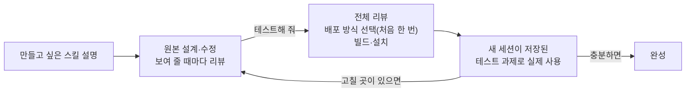

<p align="center">
  
</p>

<br />

<h3 align="center">AI 스킬을 코드처럼 만듭니다</h3>

<p align="center">스킬의 원본을 작성하고, 리뷰를 거쳐 빌드한 뒤, 설치해서 테스트합니다.<br />Skill Rails는 스킬을 만드는 스킬입니다. 코드를 다룰 때 당연하게 여기는 이 과정을 Claude Code, Codex 같은 AI 에이전트의 스킬에도 그대로 적용할 수 있습니다.</p>

<p align="right"><a href="README.md">English</a> · 한국어</p>

## 잘 만든 SKILL.md란 무엇일까

`SKILL.md`는 마크다운 파일 하나라서 누구나 쉽게 만들 수 있습니다. 스킬을 만든 세션에서 한두 번 써 보고 원하는 결과가 나오면 완성되었다고 여기기도 쉽습니다. 하지만 그 세션의 AI는 스킬을 만들며 나눈 대화를 기억하고 있습니다. 글에 빠진 내용이 있어도 대화에서 들은 의도로 채워 넣기 때문에, 그 자리에서는 빈틈이 잘 드러나지 않습니다.

오래 두고 쓸 스킬이라면 적어도 다음 여섯 가지는 확인해 볼 필요가 있습니다.

- **다른 세션에서도 똑같이 동작하는가?** 내일 새 세션을 열거나 동료가 같은 스킬을 쓰면, AI는 `SKILL.md`에 적힌 내용만 보고 일합니다. 오늘 대화에서 설명한 의도는 전해지지 않습니다.
- **같은 파일을 넣으면 늘 같은 결과가 나오는가?** 같은 형식의 CSV를 넣을 때마다 AI가 파싱 코드를 새로 작성한다면, 매번 토큰과 시간이 들고 결과도 조금씩 달라질 수 있습니다.
- **규칙에 없는 상황에서도 올바르게 판단하는가?** "환불 건을 빠뜨리지 마라", "할부는 첫 달에 몰아넣지 마라"처럼 경우마다 규칙을 쌓아 두기만 하면, 연회비나 해외 결제 수수료처럼 규칙에 없는 항목이 나왔을 때 AI가 기댈 기준이 없습니다. 규칙을 왜 두었는지 알아야 처음 보는 항목도 같은 기준으로 판단할 수 있습니다.
- **지금 하는 일에 필요한 내용만 읽는가?** 모든 경우를 `SKILL.md` 한 파일에 담으면, 할부 건이 하나도 없는 달에도 할부 처리 규칙까지 매번 읽게 되어 컨텍스트와 토큰이 낭비됩니다.
- **규칙 하나를 고쳐도 다른 동작이 깨지지 않는가?** 문제가 생길 때마다 규칙을 한 줄씩 덧붙이다 보면, 새 규칙이 기존 규칙과 충돌해 잘 되던 경우가 깨지기도 합니다. 그리고 그 사실은 한참 뒤에야 드러나곤 합니다.
- **같은 규칙을 여러 스킬에 복사해 두고 있지는 않은가?** 여러 스킬이 같은 규칙을 쓰다 보면 스킬마다 복사해 두기 쉽습니다. 그러다 한 스킬에서만 고치면 나머지는 옛 규칙대로 동작하는데, 하나하나 비교해 보기 전에는 알아차리기 어렵습니다. 저장소에서 고친 스킬과 `~/.claude/skills`에 설치된 스킬이 어긋나는 것도 같은 문제입니다.

처음부터 이 여섯 가지를 모두 갖춘 `SKILL.md`는 드뭅니다. 처음 만드는 사람은 무엇을 확인해야 하는지부터 알기 어렵고, 경험 많은 사람도 스킬을 만든 그 세션 안에서는 빈틈을 놓치기 쉽습니다. 처음에 잘 만들었더라도 고치고 기능을 늘리는 사이에 하나둘 어긋나게 됩니다. 프롬프트를 잘 쓰는 것만으로는 이 문제가 해결되지 않습니다. 만들 때는 물론, 고칠 때마다 이 점들을 다시 확인하는 절차가 필요합니다.

## 코드에는 있고, 스킬에는 없던 것

코드라면 이런 문제를 개인의 주의력에만 맡기지 않습니다. 로직은 함수로 작성하고, 같은 코드는 한 곳에 두고, 빌드 결과물은 직접 고치지 않으며, 리뷰와 테스트를 거쳐 배포합니다. 그런데 스킬에서는 아직 이 가운데 어느 것도 당연하지 않습니다. Skill Rails는 이런 방식을 스킬에 가져와, 첫 버전을 만들 때부터 적용하고 고치는 동안에도 꾸준히 지킵니다.

| 코드에서는 당연한 것 | 스킬에서는 보통 | Skill Rails |
| --- | --- | --- |
| 로직은 코드로 작성한다 | 파싱·계산·형식까지 문장으로 부탁한다 | 정확해야 하는 일은 스크립트로 분리하고, 판단할 일만 글로 남긴다 |
| 한 곳에 정의하고 가져다 쓴다 | 공통 규칙을 스킬마다 복사해 둔다 | 공통 규칙은 원본 한 곳에 두고, 빌드할 때 필요한 스킬에 넣는다 |
| 땜질 대신 원인을 고치고, 리뷰로 회귀를 잡는다 | 예외 문장을 덧붙이고, 고친 줄만 다시 본다 | 덧붙이기 전에 원인부터 찾고, 결과를 보여 주기 전과 빌드하기 전에 다시 리뷰한다 |
| 소스에서 빌드하고, 산출물이 소스와 일치하는지 확인한다 | 설치된 `SKILL.md`를 바로 고치고, 저장소 파일과 같은지는 눈으로 비교한다 | 원본 폴더(`source/`)에서 스킬 폴더(`skills/`)를 빌드하고, 설치된 스킬이 직접 수정되었는지, 원본보다 오래되었는지 명령 한 번으로 확인한다 |
| 테스트를 저장해 두고, 바꿀 때마다 깨끗한 환경에서 다시 돌린다 | 만든 세션에서 한두 번 써 본다 | 테스트 과제와 합격 기준을 원본과 함께 저장해 두고, 고친 뒤 테스트하면 대화를 모르는 새 세션의 AI가 설치된 스킬로 같은 과제를 다시 수행한다 |

새로 배워야 할 프레임워크는 없습니다. Skill Rails 자체가 스킬이므로, 평소처럼 AI에게 만들고 싶은 스킬을 이야기하면 됩니다. 원본 구조는 AI가 만들고 관리하기 때문에 직접 손댈 일은 거의 없습니다. 작은 스킬은 구조도 작습니다. 스크립트나 참고 문서가 없다면 원본은 설정 파일 두 개와 `SKILL.md`의 원본 하나로 이루어지고, 빌드 결과는 `SKILL.md`와 빌드 기록 파일 하나뿐입니다.

## 무엇이 달라지나

### 처음 읽는 AI도 이해할 수 있게 씁니다

스킬을 사용하는 AI는 그 스킬이 어떤 대화를 거쳐 만들어졌는지 알지 못합니다. Skill Rails는 이 점을 전제로 `SKILL.md`를 작성합니다. 가장 크게 달라지는 부분은 규칙을 쓰는 방식입니다. 카드 명세서를 정리하는 스킬이라면 흔히 이렇게 쓰곤 합니다.

```markdown
IMPORTANT: 환불 건을 절대 빠뜨리지 마세요.
NEVER 할부 원금 전체를 첫 달 합계에 넣지 마세요.
```

Skill Rails는 같은 내용을 이렇게 씁니다.

```markdown
월 합계는 그달 카드사가 실제로 청구한 금액이어야 합니다. 사용자가 이 합계를 명세서
총액과 대조하기 때문입니다. 따라서 할부는 이번 달 회차 금액만, 환불은 음수로 넣습니다.
이 기준으로 판단하기 어려운 항목은 합계에 넣기 전에 사용자에게 확인합니다.
```

앞의 글이 막는 것은 적혀 있는 두 경우뿐입니다. 뒤의 글은 합계가 무엇을 뜻하고 왜 그렇게 계산해야 하는지 알려 주기 때문에, 연회비나 해외 결제 수수료처럼 규칙에 없는 항목이 나와도 AI가 같은 기준으로 판단할 수 있습니다.

이 밖에도 다음과 같이 작성합니다.

- **필요할 때만 읽도록 나눕니다.** 매번 필요한 내용만 `SKILL.md`에 두고, 할부 처리처럼 가끔 필요한 내용은 "할부 내역이 있을 때만 `installments.md`를 읽는다"는 조건을 붙여 별도 파일로 분리합니다. 할부가 없는 달에는 그 파일을 읽지 않습니다.
- **전체 흐름을 먼저 보여 줍니다.** 여러 단계를 거치는 일은 단계의 순서를 맨 앞에 그려 두고, 결과물의 형식은 말로 설명하기보다 예시나 양식으로 보여 줍니다.
- **정해지지 않은 내용은 지어내지 않습니다.** 사용자가 정하지 않은 부분을 그럴듯한 문장으로 채우지 않고, 사용자에게 묻거나 아직 정해지지 않았다고 표시해 둡니다.

만들거나 고친 스킬은 사용자에게 보여 주기 전에 작성한 AI가 먼저 리뷰합니다. 스킬의 동작을 바꾸는 변경이라면 세 가지를 확인합니다. 먼저 그 스킬로 할 실제 작업을 한두 개 골라, 대화에서 들은 내용은 제쳐 두고 `SKILL.md`에 적힌 내용만 따라가면 AI가 무엇을 하게 되는지 짚어 봅니다. 다음으로 사용자의 요구와 Skill Rails의 작성 기준에 맞는지 대조합니다. 마지막으로 고치기 전보다 잃은 것은 없는지 비교합니다.

리뷰 도중 고친 곳이 생기면 처음부터 다시 보고, 빌드 직전에는 배포될 스킬 전체를 한 번 더 살펴봅니다. 결과를 보여 줄 때는 어떻게 리뷰했고 무엇을 찾았는지도 함께 알려 줍니다. 작성한 AI가 스스로 하는 리뷰에는 한계가 있으므로, 원하면 다른 에이전트에게 리뷰를 맡길 수도 있습니다. 마지막 확인은 설치 후 테스트입니다. "테스트해 줘"라고 하면 새 세션의 AI가 설치된 스킬을 실제로 사용해 봅니다.

### 계산과 형식은 스크립트가 맡습니다

`SKILL.md`에 "모든 줄을 빠짐없이 읽고 카드별 합계를 내라"고 쓰는 것은 함수 대신 주석을 배포하는 것과 같습니다. AI는 스킬을 사용할 때마다 그 주석을 다시 해석하고, 같은 계산 코드를 처음부터 새로 작성합니다.

Skill Rails는 스킬이 하는 일을 단계별로 나누어 살펴봅니다. 파싱, 집계, 형식 맞추기, 규칙 검사처럼 같은 입력에 늘 같은 답이 나와야 하는 단계는 스크립트로 만들어 스킬에 함께 담습니다. 어떤 가맹점을 어느 카테고리로 볼지, 어떤 예외를 받아들일지처럼 의미를 따져야 하는 단계는 AI가 판단합니다. 한 단계에 두 가지가 섞여 있으면, AI가 카테고리를 정하고 스크립트가 그 결과로 합계를 내는 식으로 나눕니다.

형식이 서로 다른 두 카드사의 CSV를 월별로 정리하는 스킬을 두 가지 방식으로 만들어 비교했습니다. 글로만 지시하는 스킬은 스크립트를 함께 담는 기능이 생기기 전의 Skill Rails로, 스크립트를 포함한 스킬은 현재 버전으로 만들었습니다. 그런 다음 Claude Code의 새 세션에서 같은 모델에게 새 달의 내역을 각각 두 번씩 맡기고, 미리 계산해 둔 정답과 대조했습니다.

| | 글로만 지시한 스킬 | 스크립트를 포함한 스킬 |
| --- | --- | --- |
| 1회 사용 비용 | 약 0.44달러 | 약 0.19달러 |
| 1회 소요 시간 | 48초 | 26초 |
| 계산 방식 | 사용할 때마다 계산 코드 약 1,900자를 새로 작성 | 포함된 스크립트로 계산, 두 번 모두 같은 출력 |
| 총액 정확도 | 2회 모두 정답 | 2회 모두 정답 |

정확도는 같았고, 차이는 비용과 일관성에서 났습니다. 비용은 절반 아래로, 시간은 절반 가까이로 줄었으며, 스크립트를 포함한 스킬은 두 번 모두 같은 출력을 냈습니다. 대신 스킬을 만드는 데 약 1달러가 더 들었으니, 네댓 번 사용하면 그 비용을 회수하는 셈입니다. 다만 과제 하나를 모델 하나로 비교한 결과입니다.

그렇다고 모든 것을 스크립트로 만들지는 않습니다. 스크립트도 관리해야 하는 코드이므로, 스크립트가 덜어 주는 수고가 관리 부담보다 클 때만 만듭니다. 메일 답장처럼 판단이 전부인 스킬은 글로만 작성합니다.

만든 스킬이 CHANGELOG처럼 사람도 함께 편집하는 파일에 내용을 기록해야 한다면, Skill Rails가 제공하는 기록 스크립트를 스킬에 함께 담을 수 있습니다. 이 스크립트는 표시해 둔 구역에만 쓰고, 그사이 파일이 바뀌었다면 덮어쓰지 않고 멈춥니다. 사람이 쓴 부분은 건드리지 않습니다.

### 고칠 때는 원인부터 찾습니다

프롬프트를 고치다 보면 두더지 잡기가 되기 쉽습니다. 한 곳을 막으면 다른 곳에서 문제가 튀어나오고, 문장은 길어지기만 합니다. Skill Rails는 스킬을 고칠 때 다음 원칙을 따릅니다.

- **증상이 아니라 원인을 고칩니다.** 매달 같은 가맹점이 다른 카테고리로 분류된다면, 분류 지시 문장을 또 고치기 전에 원인부터 찾습니다. 분류표가 달마다 새로 만들어져 지난달의 결정이 사라지는 구조가 원인이라면, 문장이 아니라 그 구조를 고칩니다.
- **같은 문장을 세 번째 고치게 되면 멈춥니다.** 문장 표현이 아닌 다른 곳에 원인이 있다는 신호로 보고 원인을 다시 찾습니다.
- **요청받은 방법보다 요청의 목적을 봅니다.** "이 경우를 막는 규칙을 추가해 줘"라는 요청을 받더라도, 기존 규칙을 고치는 편이 목적에 더 맞다면 근거와 함께 그 방법을 먼저 제안합니다. 어느 쪽으로 할지는 사용자가 정합니다.

### 고친 뒤에는 같은 과제로 다시 테스트합니다

규칙 하나를 고친 뒤 다른 동작이 깨지지 않았는지는 같은 과제로 다시 테스트해 봐야 알 수 있습니다. Skill Rails는 처음 테스트할 때, 실행에 앞서 테스트 과제와 합격 기준부터 제안합니다. 카드 명세서 스킬이라면 "11월 내역의 총합이 140,900원이고, 합계는 스크립트로 계산했다"처럼 결과에서 확인할 수 있는 기준입니다. 과제는 직접 정해도 되고, 따로 정하지 않으면 AI가 주된 용도에 맞는 과제 한두 개와 함께, 스킬이 필요할 때 제대로 불리는지, 비슷해 보이지만 다른 일을 하는 요청에는 불리지 않는지 확인하는 과제를 제안합니다. 동의하면 과제는 원본 옆 `tests/tasks.md`에 저장되며, 배포되는 스킬에는 포함되지 않습니다.

그다음부터는 고친 뒤 테스트할 때마다 영향을 받는 과제를 다시 실행해 저장된 기준에 비추어 판정합니다. 기준이 미리 정해져 있으므로 고치기 전 버전을 다시 돌리지 않아도 무엇이 깨졌는지 알 수 있습니다. 예를 들어 동료가 "중복 결제 거르기" 기능을 넣으면서 날짜가 다른 같은 금액의 결제까지 지워 버렸다면, 총합 기준에 걸려 빌드하기 전에 멈추고 원인을 짚어 줍니다. 근거를 댈 수 없는 항목은 통과로 인정하지 않으며, AI의 판단에 따라 달라질 수 있는 결과라면 그 한 번만 보고 고치지 않고 다시 실행해 우연이 아닌지 확인합니다.

스킬이 필요할 때 제대로 불리는지는 한 번 실행해서는 알 수 없습니다. 원하면 스킬이 불려야 할 요청과, 비슷해 보여도 불리면 안 되는 요청을 종류별로 여덟에서 열 개쯤 저장해 두고, 스킬을 사용할 도구마다 새 세션에서 요청 하나당 세 번씩 실행해 실제로 불린 비율을 측정합니다. AI는 실패한 요청을 바탕으로 설명을 고친 뒤 다시 측정합니다. 이때 요청의 일부는 따로 떼어 두고 그 결과로 최종 설명을 고르기 때문에, 설명을 고칠 때 참고한 요청에만 들어맞는 설명이 뽑히는 일을 막을 수 있습니다. 측정은 원본의 설명으로 하므로 고칠 때마다 빌드할 필요가 없습니다. 다만 실행 하나하나가 비용이 드는 실제 세션이므로, 실행 전에 몇 번을 돌릴지 알리고 동의를 받습니다.

### 원본 하나에서 빌드하고, 설치된 스킬을 검사합니다

- **공통 규칙은 한 곳에만 둡니다.** 여러 스킬이 함께 쓰는 규칙은 원본 한 곳에 두고, 빌드할 때 그 규칙을 쓰는 스킬마다 복사해 넣습니다. 규칙을 고치면 그 규칙을 쓰는 스킬만 다시 빌드하면 됩니다.
- **같은 원본은 언제나 같은 결과로 빌드되고, 빌드된 스킬은 단독으로 동작합니다.** 몇 번을 빌드해도 결과는 바이트 하나 다르지 않습니다. 따라서 빌드 결과가 바뀌었다면 원본이 바뀐 것이고, 그 차이를 diff로 그대로 리뷰할 수 있습니다. 빌드된 스킬은 표준 스킬 폴더이므로 원본 저장소나 Skill Rails 없이도 동작합니다. 스크립트가 들어 있다면 그 스크립트를 실행할 환경(예: Node.js)만 있으면 됩니다.
- **설치된 스킬이 원본과 달라지면 곧바로 알 수 있습니다.** 빌드된 스킬마다 어떤 원본으로 만들었는지 기록이 남습니다. `check`를 한 번 실행하면 설치된 스킬이 빌드 후 직접 수정되었는지, 원본보다 오래되었는지를 각각 알려 줍니다. 급한 마음에 설치된 스킬을 직접 고쳤다면, 남기고 싶은 수정을 AI가 원본으로 옮기고, 요청하면 다시 빌드해 설치본을 교체합니다.
- **배포 방식에 얽매이지 않습니다.** AI 도구의 스킬 폴더에 복사하거나, 저장소에 올려 `npx skills` 같은 설치 도구로 받거나, 플러그인으로 묶거나, 직접 정한 방식을 쓸 수 있습니다. 배포 방식을 바꾸더라도 스킬을 다시 만들 필요는 없습니다.

<details>
<summary>원본과 빌드 결과는 이렇게 생겼습니다</summary>

```text
source/                            ← 사람이 AI와 함께 고치는 원본
├─ skill-package.json              # 어떤 스킬을 빌드할지 선언
├─ modules/
│  └─ category-rules.md            # 여러 스킬이 함께 쓰는 공통 규칙
├─ tools/
│  └─ card-totals.mjs              # 스킬에 담을 스크립트
└─ targets/card-statement/
   ├─ target.json                  # 이 스킬이 쓰는 규칙·문서·스크립트
   ├─ SKILL.source.md              # SKILL.md가 될 원본
   └─ installments.md              # 할부 건이 있을 때만 여는 문서

skills/card-statement/             ← 빌드 결과물 (직접 고치지 않음)
├─ SKILL.md
├─ references/
│  ├─ installments.md
│  └─ category-rules.md
├─ scripts/
│  └─ card-totals.mjs
└─ .skill-rails-build.json         # 어떤 원본으로 빌드했는지 남긴 기록
```

</details>

### 다음 세션이 이어서 작업합니다

스킬 작업은 한 세션 안에 끝나지 않는 경우가 많습니다. Skill Rails는 새 스킬을 시작할 때 작업 기록 문서를 프로젝트에 남길지 한 번 묻습니다. 권장 구성을 선택하면 현재 상태, 어렵게 내린 결정과 그 이유, 진행 중인 계획을 저장소에 문서로 남기고, 다음 세션은 그 문서를 읽고 곧바로 작업을 이어 갑니다. AI 도구의 메모리와 달리 저장소에 남기 때문에, 동료나 다른 AI 도구도 같은 상태에서 출발할 수 있습니다. Claude Code에서 시작한 작업을 Codex에서 이어 갈 수도 있습니다. 이미 쓰고 있는 방식이 있다면 그 방식을 따르고, 필요 없다면 문서 없이 진행합니다.

<details>
<summary>남기는 문서</summary>

처음에는 `docs/current.md`를 만들고, `AGENTS.md`에 이 문서들을 언제 읽고 고칠지 적은 짧은 절을 추가합니다. `AGENTS.md`가 없으면 새로 만들고, 있으면 기존 내용은 그대로 둡니다. Claude Code처럼 자체 지침 파일(`CLAUDE.md`)을 읽는 도구라면 그 파일에 `AGENTS.md`를 가리키는 한 줄을 넣습니다. 나머지 문서는 필요할 때 만듭니다.

| 문서 | 담는 내용 |
| --- | --- |
| `docs/current.md` | 스킬의 목적과 구성, 원본과 빌드 위치, 배포 방식, 아직 답하지 못한 질문 |
| `docs/decisions/` | 쉽게 정하지 못한 결정의 결론과 그 이유 |
| `docs/plans/` | 다음 세션이 이어받을 진행 중인 계획 |
| `docs/changes/` | 테스트 결과처럼 남겨 둘 가치가 있는 변경 기록 |
| `docs/research/` | 외부에서 확인한 자료와 확인한 날짜 |

`current.md`는 늘 현재 상태로 덮어쓰고, 지난 경과는 변경 기록과 Git에 맡깁니다. 그래서 기록이 쌓여도 AI가 가장 먼저 읽는 문서는 늘 짧게 유지됩니다.

</details>

## 시작하기

Node.js 22 이상이 필요합니다.

```bash
npx skills@latest add nanomia-ai/skill-rails
```

`skills`는 여러 AI 도구에 스킬을 설치해 주는 도구입니다. 설치 과정에서 사용할 AI 도구와 설치 위치를 고를 수 있습니다. 설치가 끝나면 스킬을 만들 프로젝트에서 만들고 싶은 스킬을 AI에게 이야기하면 됩니다.

```text
Skill Rails로 두 카드사의 월별 CSV를 카테고리별로 정리하고 합계를 내는 스킬을 만들어 줘.
```



원본은 프로젝트의 `source/` 폴더에 만들어지며, 원하는 만큼 함께 다듬을 수 있습니다. 그동안에는 빌드하지 않습니다. "테스트해 줘"라고 하면 스킬 전체를 한 번 더 리뷰한 뒤, 처음에는 배포 방식을 함께 정하고 빌드해서(기본 위치는 `skills/<스킬 이름>/`) 이 컴퓨터에 설치합니다. 그런 다음 지금까지의 대화를 모르는 새 세션이나 서브에이전트가 그 스킬로 실제 작업을 해 봅니다. 첫 테스트에서는 테스트 과제와 합격 기준을 먼저 함께 정하고, 결과물뿐 아니라 스킬 때문에 불필요한 단계가 생기지 않았는지 작업 과정까지 살펴봅니다. 이후 고칠 부분은 다시 원본에서 고치고, 다음 테스트는 저장해 둔 과제로 진행합니다. 설치된 스킬이 원본보다 오래되면 AI가 알려 줍니다.

이미 쓰고 있는 스킬이 있다면 "이 스킬을 Skill Rails로 옮겨 줘"라고 하면 됩니다. AI는 원래 스킬에는 손대지 않고, 옮기기 전에 각 파일이 새 원본(`source/`)의 어디로 가는지, 설치 경로가 어떻게 바뀌는지를 정리한 대응표부터 보여 줍니다. Codex의 `agents/openai.yaml`처럼 AI가 아니라 Codex가 직접 읽는 설정 파일도 같은 경로에 함께 옮겨집니다. 스크립트가 많거나 여러 스킬이 파일을 나눠 쓰는 큰 스킬은 한 번에 옮기지 않고, 사용자와 함께 몇 단계에 걸쳐 옮깁니다. 단계마다 원래 스킬과 비교해 빠진 동작이 없는지 확인하고, 테스트할 때는 같은 테스트 과제로 원래 스킬의 결과와 비교합니다.

<details>
<summary>CLI를 직접 쓰려면</summary>

아래에서 `<skill-root>`는 설치된 `skill-rails`의 `SKILL.md`가 있는 폴더입니다.

```bash
node "<skill-root>/scripts/skill-rails-cli/src/core/cli.mjs" --help
```

| 명령 | 하는 일 |
| --- | --- |
| `build` | 스킬 하나 또는 전체를 빌드 |
| `check` | 빌드된 스킬이 직접 수정되었는지, 원본보다 오래되었는지 확인 |
| `inspect` | 공통 규칙이나 스크립트를 어떤 스킬이 쓰는지 찾음 |
| `overview` | 원본 전체 구조를 사람이 읽기 좋게 출력 |
| `start-rate` | 설명이 실제로 얼마나 잘 불리는지 각 도구의 새 세션으로 측정(실행마다 비용이 드는 실제 세션) |

</details>

## skill-creator와는 무엇이 다른가

스킬을 만드는 스킬로는 `skill-creator`가 있습니다. Codex에는 기본으로 들어 있고, Claude Code에서는 공식 플러그인으로 제공됩니다. 좋은 스킬에 대한 원칙은 Skill Rails를 포함한 세 도구가 대체로 같습니다. 규칙만 나열하지 말고 이유를 설명할 것, 가끔 필요한 내용은 필요할 때만 읽도록 나눌 것, 반복되거나 정확해야 하는 일은 스크립트로 분리할 것. 차이는 이 원칙이 실제로 지켜지게 만드는 방법과 다루는 범위에서 생깁니다.

- **실행해 보기 전에도, 작성하는 단계마다 확인합니다.** Claude의 `skill-creator`는 스킬을 실제로 돌려 보고 그 결과로 확인하는 데 강합니다. 하지만 앞에서 살펴본 빈틈 중 상당수는 테스트 과제가 그 경우를 건드리지 않으면 드러나지 않고, 고치는 과정에서 새로 생기기도 합니다. Skill Rails는 계획이나 고친 스킬을 보여 주기 전에 매번 작성 기준과 고치기 전 버전에 대조하고, 빌드 직전에는 배포될 스킬 전체를 다시 확인합니다. 테스트는 저장소의 파일이 아니라 실제로 설치된 사본으로 합니다.
- **만든 뒤의 작업에도 절차가 있습니다.** 고치는 작업은 세 도구 모두 다룹니다. 하지만 다음 작업에 대한 절차는 두 `skill-creator`에 없습니다. 여러 스킬이 공통 규칙을 한 곳에서 나눠 쓰는 일(Codex는 오히려 스킬마다 독립적으로 완결되도록 권합니다), 공통 규칙이나 스크립트를 고치기 전에 그것을 쓰는 스킬을 모두 찾는 일, 설치된 스킬이 원본과 같은지 확인하는 일, 세션을 넘어 작업 상태를 이어 가는 일, 이미 쓰던 스킬을 원본으로 옮기는 일입니다.
- **특정 에이전트에 묶이지 않습니다.** 두 `skill-creator`는 각자 자기 도구 안에서 완결됩니다. 예를 들어 설명 최적화는 `claude` CLI에서만 동작하고, 시작 설정은 Codex의 `agents/openai.yaml`에서만 다룹니다. Skill Rails는 표준 스킬 폴더를 읽는 에이전트 전반을 대상으로 합니다. 스킬을 만드는 흐름과 원본은 도구와 관계없이 하나이고, 이름으로 부를 때만 시작하게 하는 설정처럼 도구마다 다른 부분만 각 도구에 맞게 넣어 빌드합니다. 설명이 얼마나 잘 불리는지도 각 도구에서 따로 측정합니다. 팀원마다 쓰는 에이전트가 다르거나 나중에 도구를 바꾸더라도 같은 원본을 그대로 쓸 수 있습니다. 지금까지 실제로 확인한 도구는 Claude Code와 Codex입니다.

아래 표는 새 스킬을 만드는 순서에 따라 각 단계에서 세 도구가 AI에게 무엇을 하도록 하는지 비교합니다. 마지막 두 줄은 이미 있는 스킬에서 시작하는 경우와 여러 세션에 걸친 작업을 비교합니다.

| 단계 | Claude `skill-creator` | Codex `skill-creator` | Skill Rails |
| --- | --- | --- | --- |
| 요청 파악 | 용도, 스킬을 부를 문구, 출력 형식을 인터뷰로 정리함. 지금까지 대화에서 한 작업을 스킬로 만들기도 함 | 꼭 필요할 때만 묻고, 요청한 범위를 넘지 않음 | 요청의 문구보다 목적을 봄. 요청한 방법보다 나은 방법이 있으면 근거와 함께 먼저 제안하고, 목적이 불분명해 결과가 달라질 때만 질문함. 목적이나 범위를 바꾸는 결정은 사용자에게 맡김 |
| 스킬 나누기 | 다루지 않음 | 스킬마다 독립적으로 완결되게 함. 다른 스킬은 꼭 필요할 때만 참조 | 따로 시작되는 일(호출 조건이 다르거나, 별도 세션에서 하거나, 작성과 분리해야 하는 검토)만 별도 스킬로 나눔. 공통 규칙은 원본 한 곳에 두고 빌드할 때 각 스킬에 넣음. 다른 스킬에 넘기는 일이 받는 스킬 쪽에도 적혀 있는지 확인함 |
| 글과 스크립트 | 테스트에서 매번 같은 보조 코드를 작성하면 스크립트로 묶음 | 같은 코드를 반복해 작성하거나 정확한 실행이 중요하면 스크립트로 만듦 | 설계 단계에서 단계별로 나눔. 답이 정확히 정해져 있고 틀리면 결과가 달라지는 일은 스크립트가, 의미를 따지는 일은 AI가 맡고, 둘이 섞인 단계는 AI가 판단한 결과로 스크립트가 계산함. 관리 부담보다 이득이 클 때만 만듦. 사람도 편집하는 파일에는 덮어쓰지 않는 기록 스크립트를 쓸 수 있음 |
| 글쓰기 | 대문자 MUST 대신 이유를 설명함. `SKILL.md`는 500줄 이내로 하고, 나머지는 필요할 때 읽게 함 | 모델이 이미 아는 내용은 빼고 판단을 바꾸는 정보만 담음. 위험한 만큼만 구체적으로, 필요할 때 읽게 함 | 위 원칙에 더해, 만든 과정을 모르는 AI가 읽는다는 기준으로 씀. 여러 단계의 일은 전체 흐름도를 맨 앞에 두고, 한 판단에 필요한 목적과 기준은 한곳에 모으고, 같은 대상은 끝까지 같은 이름으로 부르고, 정해지지 않은 내용은 지어내지 않고 표시함 |
| 설명과 시작 방식 | 스킬이 잘 불리도록 설명을 적극적으로 쓰고, 테스트 문장 20개로 설명을 자동 최적화함 | 짧고 다른 스킬과 구분되게 씀. 이름으로 부를 때만 시작하는 설정은 사용자가 요청할 때만 쓰고, 민감한 작업도 자동 시작은 허용하되 실행 직전에 승인받게 함 | 사용자가 쓰는 말로, 비슷한 스킬과 구분되게 씀. 배포·전송·삭제처럼 사용자가 결정해야 할 결과를 내는 스킬은 이름으로 부를 때만 시작하게 하고, Claude Code와 Codex 각각의 설정에 반영함. 이름이나 설명이 도구들이 받아들이는 형식(설명 1,024자 이내 등)을 벗어나면 빌드가 멈춤. 설명이 바뀌면 시작해야 할 요청과, 비슷해 보여도 시작하면 안 되는 요청을 각 도구의 새 세션에 보내 확인함. 원하면 요청을 종류별로 여덟에서 열 개쯤으로 늘려 세 번씩 실행해 시작 비율을 재고, 일부 요청을 떼어 둔 채 설명을 고쳐 가며 그 결과로 최종 설명을 고름 |
| 리뷰 | 고친 초안을 새로운 눈으로 다시 읽어 보기를 권함 | 형식 검사 스크립트(머리말·이름·남은 자리표시자)를 돌린 뒤 설명·의도·참조를 점검함 | 계획이나 고친 스킬을 보여 주기 전에는 매번, 빌드 직전에는 스킬 전체를 리뷰함. 동작을 바꾸는 변경이면 실제 과제 한두 개를 스킬을 쓸 AI의 입장에서 따라 읽고, 작성 기준과 대조하고, 고치기 전보다 잃은 것이 없는지 비교함. 리뷰 중 고친 곳이 생기면 처음부터 다시 봄 |
| 빌드·설치 | 스킬 폴더를 그대로 씀. 파일 전달 기능이 있는 환경에서만 마지막에 `.skill` 파일로 묶음 | 스킬 폴더에 바로 작성함 | 원본에서 늘 같은 결과로 빌드하고 빌드 기록을 남김. 배포 방식(폴더 복사, `npx skills`, 플러그인 등)을 골라 기록해 둠. `check`로 설치된 스킬이 직접 수정되었는지, 원본보다 오래되었는지 확인함 |
| 테스트 | 과제를 저장해 두고, 회차마다 스킬이 없을 때(또는 고치기 전 버전)와 나란히 실행해 통과율·시간·토큰을 측정함. 확인 항목은 실행 중에 작성하고, 다른 에이전트가 근거와 함께 채점함. 결과 화면에서 사람이 평가하며, 원하면 블라인드 비교도 함 | 형식 검사. 복잡하거나 위험한 스킬은 정답을 알려 주지 않은 서브에이전트에게 실제 과제를 맡김 | 과제와 합격 기준을 실행 전에 정해 원본 옆에 저장하고, 대화를 모르는 새 세션이 실제로 설치된 스킬을 사용함. 근거가 없는 항목은 통과로 치지 않고, 결과물과 작업 과정을 함께 봄. 고친 뒤에는 영향을 받는 과제를 다시 실행해 저장된 기준으로 회귀를 가려내므로 이전 버전은 다시 돌리지 않음. 스크립트나 설정 파일이 든 스킬은 설치 도구가 파일을 빠뜨리거나 바꾸지 않았는지 설치본을 `check`하고 스크립트를 직접 실행해 봄 |
| 고치기 | 몇 개 예시에만 맞추지 말고 일반화함. 실행 기록을 읽고 쓸모없는 지시는 뺌 | 실제 사용과 드러난 실패를 근거로 범위를 좁혀 고침 | 공통 규칙이나 스크립트를 고치기 전에 그것을 쓰는 스킬을 모두 찾아 함께 봄. 증상이 보인 곳이 아니라 원인이 있는 곳을 고침. 덧붙이기 전에 지우거나 합칠 수 있는지 먼저 보고, 같은 문장을 세 번째 고치게 되면 멈추고 원인을 다시 찾음 |
| 이미 있는 스킬 | 고치기 전 버전을 저장해 두고 같은 과제로 새 버전과 비교함 | 필요한 부분만 고치고 기존 시작 설정은 유지함 | 원래 스킬은 그대로 둔 채, 각 파일이 어디로 가는지 대응표부터 보여 주고 원본으로 옮김. 큰 스킬은 사용자와 함께 몇 단계에 걸쳐 옮기고, 단계마다 원래 스킬과 같은 일을 맡겨 비교함 |
| 다음 세션 | 회차별 결과를 작업 폴더에 보관함 | 다루지 않음 | 현재 상태, 결정과 그 이유, 진행 중인 계획을 저장소 문서로 남겨 다른 세션, 동료, 다른 AI 도구가 이어받게 함 |

반대로 Claude의 `skill-creator`가 더 나은 점도 있습니다. 회차마다 스킬이 없을 때(또는 고치기 전 버전)와 나란히 실행해 통과율·시간·토큰을 숫자로 비교하고, 결과를 화면에 띄워 사람이 과제마다 의견을 남길 수 있게 합니다. 설명 다듬기는 두 도구 모두 지원하지만, `skill-creator`는 설명을 고치는 Claude를 별도로 띄워 떼어 둔 요청을 아예 보여 주지 않습니다. Skill Rails에서는 지금 대화 중인 AI가 설명을 고치므로, 떼어 둔 요청의 결과는 개수로만 전달받지만 요청 자체는 저장된 파일에서 읽을 수 있습니다. 또 Skill Rails는 스킬이 없을 때와의 비교를 도입이나 배포를 결정할 때만 하며, 결과 화면은 없습니다. `skill-creator`는 원본과 빌드를 따로 두지 않아 익혀야 할 것도 적습니다. 따라서 Claude에서 스킬 하나를 빠르게 만들고 결과를 숫자로 확인하고 싶다면 `skill-creator`가, 여러 스킬이 규칙을 나눠 쓰고 여러 에이전트에서 오래 고쳐 가며 쓸 스킬이라면 Skill Rails가 잘 맞습니다.

이 비교는 2026년 11월 기준으로 각 `skill-creator`의 `SKILL.md`를 읽고 정리했습니다.

## 더 읽을 거리

- [Skill Rails 본문](skills/skill-rails/SKILL.md): 스킬을 만드는 AI가 읽는 지침
- [스킬을 기획하고 고칠 때 쓰는 판단 방법](source/modules/skill-evolution-method_ko.md)
- [제품 목적과 구조](docs/skill-rails_ko.md)
- [구현과 검증 범위](docs/implementation-verification_ko.md)

[Apache-2.0](LICENSE)
