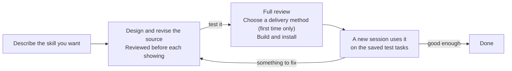

<p align="center">
  
</p>

<br />

<h3 align="center">Build AI skills the way you build code</h3>

<p align="center">Write a skill's source, review it, build it, then install and test it.<br />Skill Rails is a skill for making skills. It brings the process you take for granted with code to the skills of AI agents such as Claude Code and Codex.</p>

<p align="right">English · <a href="README.ko.md">한국어</a></p>

## What makes a good SKILL.md?

A `SKILL.md` is a single Markdown file, so anyone can write one easily. It is just as easy to call it finished once it gives the result you wanted after a try or two in the session where you wrote it. But the AI in that session remembers the conversation in which the skill was made. Even when something is missing from the text, it fills the gap with the intent it heard in that conversation, so the gaps rarely show at that point.

For a skill you plan to keep using, it is worth checking at least these six things.

- **Does it behave the same in another session?** When you open a new session tomorrow, or a colleague uses the same skill, the AI works only from what is written in `SKILL.md`. The intent you explained in today's conversation does not carry over.
- **Does the same file always produce the same result?** If the AI writes new parsing code every time it receives a CSV in the same format, every run costs tokens and time, and the results can vary slightly.
- **Does it judge correctly in situations the rules do not cover?** If you only pile up a rule for each case, such as "Never miss a refund" or "Don't put the whole installment in the first month," the AI has no standard to fall back on when an item the rules never mention, such as an annual fee or a foreign transaction fee, comes up. Only when it knows why a rule exists can it judge an unfamiliar item by the same standard.
- **Does it read only what the current task needs?** If every case goes into the one `SKILL.md`, the installment rules are read every time, even in a month with no installments at all, and context and tokens are wasted.
- **Can you change one rule without breaking other behavior?** If you keep adding a line of rules each time a problem appears, a new rule can conflict with an existing one and break cases that used to work. And that often comes to light only much later.
- **Are you copying the same rule into several skills?** When several skills use the same rule, it is easy to keep a copy in each. Then, if you fix it in only one skill, the others keep following the old rule, and that is hard to notice until you compare them one by one. A skill fixed in the repository drifting apart from the copy installed in `~/.claude/skills` is the same problem.

Few `SKILL.md` files meet all six from the start. A first-time author may not know what to check in the first place, and even an experienced author can easily miss gaps inside the very session where the skill was written. Even a skill that starts out well drifts here and there as it is fixed and extended. Writing good prompts alone does not solve this. You need a process that checks these points again, not only when the skill is made but every time it is changed.

## What code has, and skills have lacked

With code, we do not leave these problems to individual attention. Logic is written as functions, the same code lives in one place, build output is never edited by hand, and changes ship only after review and testing. With skills, none of this is a given yet. Skill Rails brings these practices to skills, applying them from the first version and keeping them up while the skill is changed.

| What code takes for granted | What skills usually do | Skill Rails |
| --- | --- | --- |
| Write logic as code | Ask in sentences for parsing, calculation, and formatting too | Separate work that must be exact into scripts and leave only judgment in prose |
| Define once and reuse | Copy shared rules into each skill | Keep shared rules in one place in the source and put them into each skill that needs them at build time |
| Fix the cause instead of patching, and catch regressions in review | Append exception sentences and reread only the changed line | Look for the cause before adding anything, and review again before showing a result and before building |
| Build from source and confirm the output matches it | Edit the installed `SKILL.md` directly and eyeball whether it matches the repository file | Build the skill folder (`skills/`) from the source folder (`source/`), and confirm with one command whether an installed skill was edited by hand or is older than its source |
| Keep tests and rerun them in a clean environment after every change | Try it once or twice in the session where it was written | Save test tasks and pass criteria with the source; when you test after a change, an AI in a new session that does not know the conversation performs the same tasks again with the installed skill |

There is no new framework to learn. Skill Rails is itself a skill, so you simply tell the AI what skill you want, as you normally would. The AI creates and manages the source structure, so you will rarely need to touch it yourself. A small skill gets a small structure: with no scripts or reference documents, the source consists of two configuration files and one source for `SKILL.md`, and the build output is just `SKILL.md` and a single build record file.

## What changes

### Written so an AI reading it for the first time can understand it

The AI that uses a skill does not know what conversation the skill came out of. Skill Rails writes `SKILL.md` on that premise. The biggest change is in how rules are written. A skill that organizes card statements is often written like this:

```markdown
IMPORTANT: Never miss a refund.
NEVER put the full installment principal in the first month's total.
```

Skill Rails writes the same content like this:

```markdown
The monthly total must be the amount the card issuer actually billed that month, because
the user checks this total against the statement total. So include only this month's
installment amount, and enter refunds as negative amounts. Before adding an item this
standard cannot decide, ask the user.
```

The first version blocks only the two cases it names. The second explains what the total means and why it must be calculated that way, so even when an item the rules never mention, such as an annual fee or a foreign transaction fee, comes up, the AI can judge it by the same standard.

It also writes skills in these ways:

- **Split so that content is read only when needed.** Only what is needed every time stays in `SKILL.md`. Content needed only occasionally, such as installment handling, moves into a separate file with a condition attached: "Read `installments.md` only when there are installment charges." In a month with no installments, that file is never read.
- **Show the whole flow first.** For work that goes through several stages, the order of the stages is drawn at the very top, and the format of a result is shown with an example or a template rather than described in words.
- **Do not invent what has not been decided.** Instead of filling in what the user has not decided with plausible sentences, it asks the user or marks the point as not yet decided.

Before a new or changed skill is shown to the user, the AI that wrote it reviews it first. If the change alters what the skill does, it checks three things. First, it picks one or two real tasks for the skill and, setting aside what it heard in the conversation, traces what an AI following only the text of `SKILL.md` would end up doing. Next, it checks the result against the user's requirements and Skill Rails's writing criteria. Finally, it compares it with the version before the change to see whether anything was lost.

If anything is fixed during the review, it reviews again from the start, and right before a build it looks over the whole skill as it will ship once more. When it shows you the result, it also tells you how it reviewed and what it found. A review by the AI that wrote the skill has its limits, so you can also hand the review to another agent if you want. The final check is the post-install test: say "test it," and an AI in a new session actually uses the installed skill.

### Scripts handle calculation and formatting

Writing "Read every line without missing any and total each card" in `SKILL.md` is like shipping a comment instead of a function. Every time the skill is used, the AI interprets that comment again and writes the same calculation code from scratch.

Skill Rails looks at what a skill does step by step. Steps that must always give the same answer for the same input, such as parsing, aggregation, formatting, and rule checks, become scripts packaged with the skill. Steps that require weighing meaning, such as which category a merchant belongs to or whether to accept an exception, are left to the AI's judgment. When one step mixes the two, it is split: the AI decides the category, and a script takes that result and computes the total.

We built a skill that organizes CSVs from two card issuers with different formats by month, in two ways, and compared them. The prose-only skill was made with a version of Skill Rails from before it could package scripts with a skill, and the script-backed skill with the current version. Then, in new Claude Code sessions with the same model, each skill was given a new month's statements twice, and the results were checked against answers calculated in advance.

| | Prose-only skill | Script-backed skill |
| --- | --- | --- |
| Cost per use | about $0.44 | about $0.19 |
| Time per use | 48 s | 26 s |
| How it calculated | Wrote about 1,900 characters of calculation code anew on every use | Calculated with the packaged script; identical output both times |
| Accuracy of the totals | Correct both times | Correct both times |

Accuracy was the same; the difference lay in cost and consistency. Cost fell to less than half and time to nearly half, and the script-backed skill produced identical output both times. In exchange, building the skill cost about $1 more, so it pays for itself after four or five uses. Note that this compares one task on one model.

That does not mean everything becomes a script. Scripts are code that must be maintained too, so one is made only when the effort it saves outweighs the cost of maintaining it. A skill that is all judgment, such as replying to email, is written in prose alone.

If a skill you build needs to write into a file that people also edit, such as a CHANGELOG, you can package the record script that Skill Rails provides with it. The script writes only inside a marked region, and if the file has changed in the meantime, it stops instead of overwriting. It never touches the parts people wrote.

### When fixing, find the cause first

Fixing prompts easily turns into whack-a-mole. Block one spot and a problem pops up somewhere else, and the text only grows longer. When fixing a skill, Skill Rails follows these principles.

- **Fix the cause, not the symptom.** If the same merchant lands in a different category every month, it looks for the cause before rewording the classification instruction yet again. If the cause turns out to be a structure in which the category table is recreated every month and last month's decisions are lost, it fixes that structure, not the sentence.
- **Stop when the same sentence needs a third fix.** It takes that as a sign that the cause lies somewhere other than the wording, and looks for the cause again.
- **Look at the purpose of a request rather than the method requested.** Even when asked to "add a rule that blocks this case," if fixing an existing rule would better serve the purpose, it proposes that first, with its reasons. Which way to go is the user's decision.

### After a fix, test again with the same tasks

Whether fixing one rule broke some other behavior can only be known by testing again with the same tasks. The first time you test, Skill Rails proposes test tasks and pass criteria before running anything. For a card statement skill, that means a criterion you can check in the result, such as "the November total is 140,900 won, and the total was computed by the script." You can set the tasks yourself; if you don't, the AI proposes one or two tasks for the skill's main use, along with tasks that check whether the skill is invoked when it is needed and stays out of requests that look similar but call for something else. Once you agree, the tasks are saved in `tests/tasks.md` next to the source and are not included in the skill that ships.

From then on, each time you test after a change, the affected tasks run again and are judged against the saved criteria. Because the criteria were set in advance, you can tell what broke without running the version from before the change again. For example, if a colleague adds "duplicate charge filtering" and it also deletes charges of the same amount made on different dates, the total criterion catches it, and the work stops before the build and points to the cause. An item for which no evidence can be shown does not count as passed, and if a result could vary with the AI's judgment, it does not make a fix based on that single run but runs it again to confirm the result was not chance.

Whether a skill is invoked when it should be cannot be told from a single run. If you want, eight to ten requests of each kind, ones that should invoke the skill and ones that look similar but should not, are saved, and each request is run three times in a new session of every tool that will use the skill, measuring how often the skill was actually invoked. The AI revises the description based on the failed requests and measures again. Some of the requests are held out, and the final description is chosen by their results, which keeps a description that fits only the requests consulted while revising from being picked. Measurement uses the description in the source, so there is no need to build after every revision. Each run, however, is a real session that costs money, so you are told how many runs it will take and asked to agree before it starts.

### Build from one source, and check installed skills

- **Keep shared rules in one place.** Rules that several skills use live in one place in the source, and at build time they are copied into each skill that uses them. When you change a rule, you rebuild only the skills that use it.
- **The same source always builds to the same result, and a built skill works on its own.** However many times you build, the output does not differ by a single byte. So if the build output changed, the source changed, and you can review that difference as a diff. A built skill is a standard skill folder, so it works without the source repository or Skill Rails. If it contains scripts, all it needs is an environment to run them (for example, Node.js).
- **You know right away when an installed skill differs from its source.** Each built skill keeps a record of the source it was built from. Run `check` once and it tells you, separately, whether the installed skill was edited by hand after the build and whether it is older than its source. If you edited an installed skill directly in a hurry, the AI moves the changes you want to keep into the source and, when you ask, rebuilds and replaces the installed copy.
- **You are not tied to one delivery method.** You can copy the skill into an AI tool's skill folder, push it to a repository and install it with a tool such as `npx skills`, bundle it as a plugin, or use a method of your own. Changing the method does not mean remaking the skill.

<details>
<summary>What the source and build output look like</summary>

```text
source/                            ← the source people edit together with the AI
├─ skill-package.json              # declares which skills to build
├─ modules/
│  └─ category-rules.md            # shared rules that several skills use
├─ tools/
│  └─ card-totals.mjs              # script packaged with the skill
└─ targets/card-statement/
   ├─ target.json                  # rules, documents, and scripts this skill uses
   ├─ SKILL.source.md              # source that becomes SKILL.md
   └─ installments.md              # document opened only when there are installment charges

skills/card-statement/             ← build output (never edited by hand)
├─ SKILL.md
├─ references/
│  ├─ installments.md
│  └─ category-rules.md
├─ scripts/
│  └─ card-totals.mjs
└─ .skill-rails-build.json         # record of the source it was built from
```

</details>

### The next session picks up the work

Skill work often does not finish in a single session. When you start a new skill, Skill Rails asks once whether to keep work records in the project. If you choose the recommended set, the current state, decisions that were hard to make and their reasons, and plans in progress are kept as documents in the repository, and the next session reads them and continues right away. Unlike an AI tool's memory, these records live in the repository, so colleagues and other AI tools can start from the same state. You can also start work in Claude Code and continue it in Codex. If you already have your own way of keeping records, it follows that, and if you do not need records, it proceeds without them.

<details>
<summary>The documents it keeps</summary>

At first, it creates `docs/current.md` and adds a short section to `AGENTS.md` saying when to read and update these documents. If there is no `AGENTS.md`, it creates one; if there is, the existing content stays as it is. For a tool that reads its own instruction file, as Claude Code reads `CLAUDE.md`, it adds one line to that file pointing to `AGENTS.md`. The other documents are created only when they are needed.

| Document | What it holds |
| --- | --- |
| `docs/current.md` | The skill's purpose and makeup, where the source and builds live, the delivery method, and questions not yet answered |
| `docs/decisions/` | The conclusion of each decision that was not easy to make, and the reasons for it |
| `docs/plans/` | Plans in progress for the next session to take over |
| `docs/changes/` | Change records worth keeping, such as test results |
| `docs/research/` | Material confirmed from outside sources, with the date it was checked |

`current.md` is always overwritten with the current state, and past history is left to the change records and Git. So however many records pile up, the document the AI reads first always stays short.

</details>

## Getting started

Requires Node.js 22 or later.

```bash
npx skills@latest add nanomia-ai/skill-rails
```

`skills` is a tool that installs skills into many AI tools. During installation you can choose which AI tools to use and where to install. Once it is installed, open the project where you want to build a skill and tell the AI what skill you want.

```text
Using Skill Rails, make a skill that organizes two card issuers' monthly CSVs by category and totals them.
```



The source is created in the project's `source/` folder, and you can refine it together as much as you like. Nothing is built in the meantime. When you say "test it," the whole skill is reviewed once more; the first time, you choose a delivery method together, and the skill is then built (by default into `skills/<skill name>/`) and installed on this computer. Next, a new session or a subagent that does not know the conversation so far does real work with that skill. In the first test, you first agree on test tasks and pass criteria, and it examines not only the results but also how the work went, to see whether the skill caused any unnecessary steps. After that, further fixes are made in the source again, and the next test runs on the saved tasks. If an installed skill falls behind its source, the AI tells you.

If you already have a skill, just say "Move this skill into Skill Rails." The AI leaves the original skill untouched and, before moving anything, first shows a mapping table of where each file goes in the new source (`source/`) and how install paths change. Configuration files that Codex reads directly rather than the AI, such as Codex's `agents/openai.yaml`, move along to the same paths. A large skill with many scripts, or with files shared across several skills, is not moved all at once but over several steps with you. At each step, it checks against the original skill that no behavior is missing, and when testing, it compares the results with the original skill's on the same test tasks.

<details>
<summary>Using the CLI directly</summary>

Below, `<skill-root>` is the folder that contains the installed `skill-rails`'s `SKILL.md`.

```bash
node "<skill-root>/scripts/skill-rails-cli/src/core/cli.mjs" --help
```

| Command | What it does |
| --- | --- |
| `build` | Builds one skill or all of them |
| `check` | Checks whether a built skill was edited by hand or is older than its source |
| `inspect` | Finds which skills use a shared rule or script |
| `overview` | Prints the whole source structure in a form people can read easily |
| `start-rate` | Measures how reliably the description gets the skill invoked, in new sessions of each tool (every run is a real session that costs money) |

</details>

## How is it different from skill-creator?

There is also `skill-creator`, a skill for making skills. Codex includes it by default, and Claude Code offers it as an official plugin. The three, Skill Rails included, largely agree on what makes a good skill: explain the reasons instead of just listing rules, split off occasionally needed content so it is read only when needed, and move repetitive or exactness-critical work into scripts. The differences lie in how those principles are actually made to hold, and in how much ground each one covers.

- **It checks at every writing step, even before anything runs.** Claude's `skill-creator` is strong at checking a skill by actually running it and examining the results. But many of the gaps described above do not show unless a test task happens to touch that case, and new ones appear while a skill is being fixed. Skill Rails checks the draft against its writing criteria and the version before the change every time before showing a plan or a changed skill, and right before a build it checks the whole skill as it will ship once more. Tests use the copy actually installed, not the files in the repository.
- **The work after creation has a process too.** All three handle fixing skills. But neither `skill-creator` has a process for the following: several skills sharing common rules from one place (Codex, in fact, recommends that each skill be fully self-contained), finding every skill that uses a shared rule or script before changing it, confirming that an installed skill matches its source, carrying the state of work across sessions, and moving an existing skill into a source package.
- **It is not tied to a particular agent.** Each `skill-creator` is complete within its own tool. For example, description optimization runs only on the `claude` CLI, and the start setting is handled only through Codex's `agents/openai.yaml`. Skill Rails is meant for any agent that reads standard skill folders. The way a skill is made, and its source, are one and the same whatever the tool; only the parts that differ by tool, such as the setting that makes a skill start only when called by name, are built in for each tool. How reliably the description gets the skill invoked is also measured in each tool separately. Even if team members use different agents, or you switch tools later, the same source keeps working as it is. The tools actually verified so far are Claude Code and Codex.

The table below follows the order in which a new skill is made and compares what each of the three has the AI do at each stage. The last two rows compare starting from an existing skill and working across multiple sessions.

| Stage | Claude `skill-creator` | Codex `skill-creator` | Skill Rails |
| --- | --- | --- | --- |
| Understanding the request | Organizes the use, the phrases that should invoke the skill, and the output format through an interview. May also turn work done earlier in the conversation into a skill | Asks only when truly necessary and stays within the requested scope | Looks at the purpose rather than the wording of a request. If there is a better way than the method requested, proposes it first with its reasons, and asks only when an unclear purpose would change the outcome. Leaves decisions that change the purpose or scope to the user |
| Splitting skills | Not covered | Keeps each skill self-contained; refers to other skills only when truly necessary | Splits off into a separate skill only work that starts independently (a different invocation condition, a separate session, or a review that must be kept apart from the writing). Keeps shared rules in one place in the source and puts them into each skill at build time. Checks that work handed to another skill is also written down on the receiving skill's side |
| Prose and scripts | Bundles helper code into a script when the same code gets written in every test | Makes a script when the same code is written repeatedly or exact execution matters | Splits the work step by step at design time. Work whose answer is exactly determined and would change the result if wrong goes to scripts, work that weighs meaning goes to the AI, and in mixed steps a script calculates from what the AI judged. Makes a script only when the gain outweighs the maintenance cost. A record script that never overwrites is available for files people also edit |
| Writing | Explains reasons instead of uppercase MUSTs. Keeps `SKILL.md` under 500 lines and has the rest read when needed | Leaves out what the model already knows and keeps only information that changes decisions. As specific as the risk warrants; read when needed | On top of those principles, writes for an AI that does not know how the skill was made. Puts a map of the whole flow first for multi-stage work, gathers the purpose and criteria for one judgment in one place, calls the same thing by the same name throughout, and marks undecided points instead of inventing them |
| Description and how it starts | Writes descriptions assertively so the skill gets invoked, and optimizes the description automatically with 20 test queries | Short and distinct from other skills. Uses the setting that starts a skill only when named only if the user asks; even sensitive work keeps automatic start but asks for approval right before acting | Written in the user's words and distinct from similar skills. A skill whose results the user should decide on, such as deploying, sending, or deleting, starts only when called by name, set in both Claude Code's and Codex's own settings. The build stops if the name or description breaks the format the tools accept (a description within 1,024 characters, and so on). When the description changes, sends requests that should start the skill and requests that look similar but should not to new sessions of each tool to check. If you want, expands the requests to eight to ten of each kind, runs each three times to measure the start rate, and revises the description with some requests held out, choosing the final one by their results |
| Review | Recommends rereading a revised draft with fresh eyes | Runs a format-check script (frontmatter, name, leftover placeholders), then reviews the description, intent, and references | Reviews every time before showing a plan or a changed skill, and the whole skill right before a build. For a change that alters behavior, reads one or two real tasks through as the AI that will use the skill would, checks against the writing criteria, and compares with the version before the change for anything lost. If anything is fixed during review, starts over |
| Build and install | Uses the skill folder as is; packages it as a `.skill` file at the end only where file delivery is available | Writes directly into the skill folder | Builds from the source to the same result every time and keeps a build record. Chooses and records a delivery method (folder copy, `npx skills`, plugin, and so on). Uses `check` to confirm whether an installed skill was edited by hand or is older than its source |
| Testing | Saves tasks and, in each iteration, runs them side by side with no skill (or the previous version), measuring pass rate, time, and tokens. Assertions are written during the run and graded with evidence by another agent. People review the results in a viewer; blind comparison is optional | Format check. For complex or risky skills, gives a real task to a subagent that is not told the answer | Sets tasks and pass criteria before running and saves them next to the source; a new session that does not know the conversation uses the actually installed skill. Items without evidence do not count as passed, and both the results and how the work went are examined. After a change, the affected tasks run again and regressions are identified against the saved criteria, so the previous version is not rerun. For skills that contain scripts or configuration files, runs `check` on the installed copy and runs the scripts directly to confirm the installer did not drop or alter files |
| Fixing | Generalizes rather than fitting a few examples; reads run transcripts and removes unhelpful instructions | Makes narrow fixes grounded in real use and observed failures | Before changing a shared rule or script, finds every skill that uses it and reviews them together. Fixes where the cause is, not where the symptom showed. Before adding anything, first sees whether something can be removed or merged; when the same sentence needs a third fix, stops and looks for the cause again |
| Existing skills | Saves the previous version and compares it with the new one on the same tasks | Changes only what is needed and keeps the existing start setting | Leaves the original skill as it is, first shows a mapping table of where each file goes, then moves it into the source. Moves a large skill over several steps with the user, giving the original the same work at each step for comparison |
| Next session | Keeps per-iteration results in a workspace folder | Not covered | Keeps the current state, decisions and their reasons, and plans in progress as documents in the repository, so other sessions, colleagues, and other AI tools can take over |

Claude's `skill-creator` is better in some respects, too. In each iteration, it runs side by side with no skill (or the previous version) to compare pass rate, time, and tokens in numbers, and it shows the results in a viewer where people can leave feedback on each task. Both refine descriptions, but `skill-creator` launches a separate Claude to revise the description and never shows it the held-out requests at all. In Skill Rails, the AI in the current conversation revises the description, so it receives the held-out results only as counts, though the requests themselves can be read in the saved file. Skill Rails also compares against running without the skill only when deciding on adoption or release, and it has no results viewer. And because `skill-creator` does not separate source from build, there is less to learn. So if you want to make one skill quickly in Claude and measure the results in numbers, `skill-creator` is the better fit; for skills that share rules with one another and that you will keep revising for a long time across several agents, Skill Rails is the better fit.

This comparison was compiled in November 2026 from reading each `skill-creator`'s `SKILL.md`.

## Further reading

- [The Skill Rails body](skills/skill-rails/SKILL.md): the instructions the skill-building AI reads
- [How to plan and revise skills (Korean)](source/modules/skill-evolution-method_ko.md)
- [Product purpose and structure (Korean)](docs/skill-rails_ko.md)
- [Implementation and verification scope (Korean)](docs/implementation-verification_ko.md)

[Apache-2.0](LICENSE)
